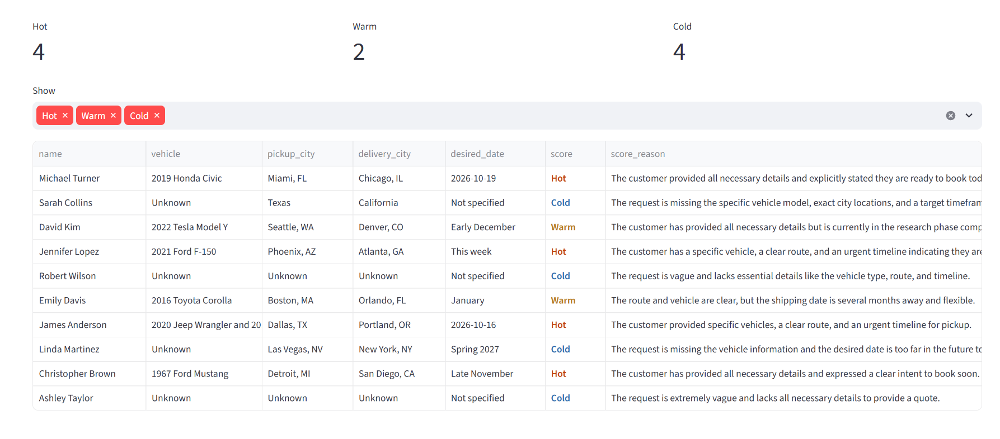

# AI Lead Qualifier

At my last job I read hundreds of vehicle transport quote requests a week. Most of the time went into figuring out the basics: what car, from where, to where, when, and is this person actually ready to book. This app does that first pass.

You give it a CSV of raw requests. For each one it pulls out the vehicle, pickup city, delivery city and date, scores the lead Hot / Warm / Cold with a one-line reason, and drafts a follow-up email you can edit before sending.

**Demo:** https://ai-lead-qualifier-mwbmqp4tzt6aifyytdgv8x.streamlit.app/ (free hosting, it may take a minute to wake up)



## How it works

- `qualifier.py` sends each request to Google Gemini with the scoring rules and asks for JSON back. The response is checked before it is used: unknown fields are dropped and anything that is not Hot / Warm / Cold becomes Cold.
- `app.py` is the Streamlit interface: lead cards, filters, search, editable emails, CSV and email export.
- It also runs without the interface: `python qualifier.py sample_leads.csv results.csv`

## Problems I hit

- **The model kept going down.** The newest Gemini model returned 503 (overloaded) and 429 (quota) on most requests. I added retries with growing waits (5, 10, 20 seconds) for those two errors only, a pause between requests, and a button that retries just the failed leads instead of the whole batch.
- **A model I used was switched off.** `gemini-2.5-flash` started returning 404 for new accounts. The model name now comes from an environment variable, so changing it does not need a code change.
- **One bad response used to break the run.** Every lead is processed on its own, and a failure is saved as an `Error` row with the reason, so the other leads still finish.

## Tests

```bash
pip install -r requirements-dev.txt
pytest
```

The tests use a fake Gemini client, so they run without an API key: JSON parsing (including responses wrapped in code fences), score normalisation, retrying only on 503 / 429, and that one failed lead does not stop the batch.

## Run it locally

```bash
pip install -r requirements.txt
cp .env.example .env   # add your free key from aistudio.google.com
streamlit run app.py
```
